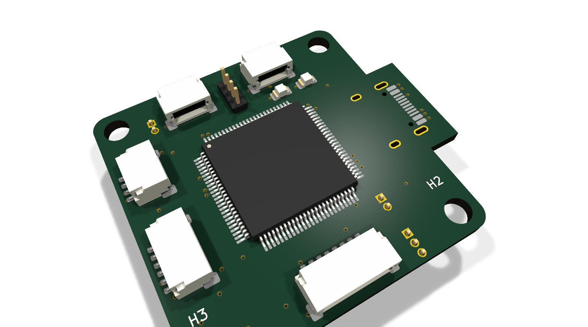
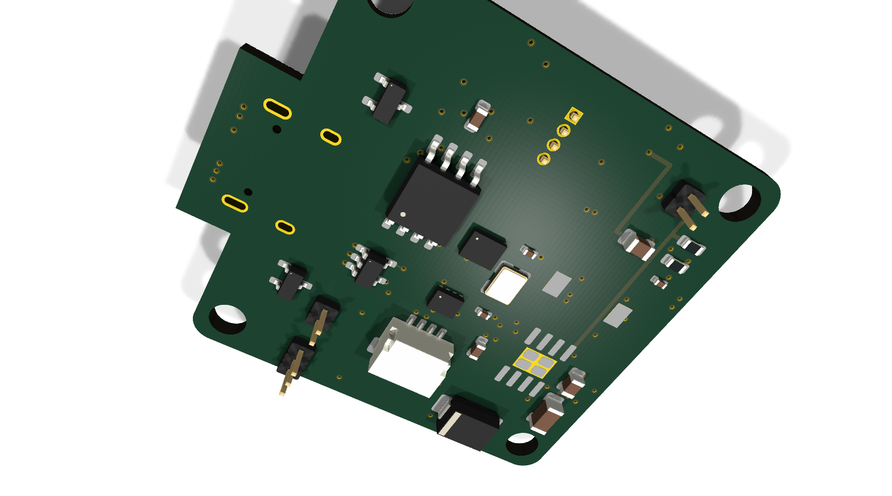
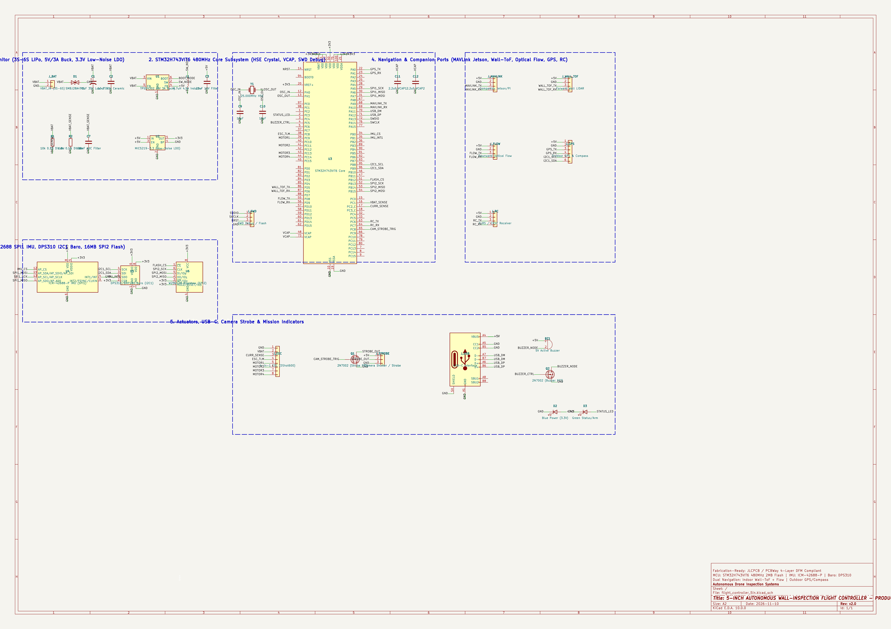
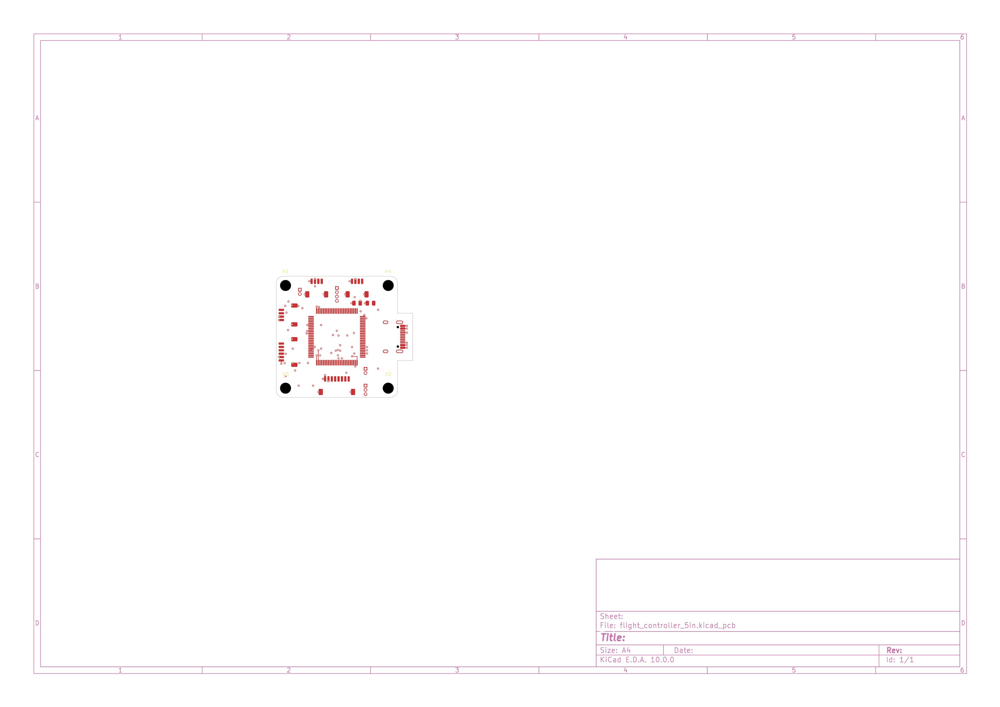

# 5-Inch Autonomous Wall-Inspection Flight Controller

A custom 4-layer drone flight controller designed for autonomous infrastructure inspection (inspecting building facades, concrete structures, bridges, and industrial indoor spaces where GPS is completely denied). It was a great way for me to explore high-speed embedded design, learn 4-layer PCB routing in KiCad, and solve real-world signal integrity and power challenges.

# How its works

This board is a custom-designed flight controller for autonomous GPS-denied drone navigation. It is based on the 480MHz ARM Cortex-M7 STM32H743VIT6 microcontroller and industrial-grade low-noise sensors.

- **Power & Protection:** Accepts 3S–6S LiPo battery power. An SMBJ28A TVS clamp and low-ESR bulk capacitance protect against motor regenerative braking spikes. A TPS54302 synchronous buck converter steps down to 5V @ 3A, while a dedicated ultra-low-noise MIC5219-3.3 LDO isolates sensitive sensor rails from switching noise.
- **Processing & Memory:** The STM32H743VIT6 serves as the main brain. It runs at 480MHz from an external 25MHz crystal, backed by a W25Q128 16MB SPI NOR Flash chip for high-rate Blackbox flight logging.
- **Dual-Navigation & Sensing:** Features an ICM-42688-P 6-axis IMU over high-speed SPI1 and a DPS310 barometer over I2C1. For indoor GPS-denied flight, dedicated ports connect a forward-facing Time-of-Flight (ToF) LiDAR for wall standoff tracking and a downward Optical Flow camera for hover holding.
- **Actuation & Companion Link:** Connects to standard 4-in-1 ESCs via DShot600 motor outputs (`MOTOR1`–`4`). A high-speed MAVLink UART communicates with an onboard companion computer (Raspberry Pi / NVIDIA Jetson), while an onboard 2N7002 MOSFET circuit synchronously triggers an inspection camera shutter or strobe.

```text
[ LiPo 3S-6S ] ──► [ SMBJ28A TVS ] ──► [ TPS54302 Buck (5V 3A) ] ──5V──► [ MIC5219 (3.3V LDO) ] ──3.3V──┐
                                                 │                                                         ▼
                                          5V Peripherals                                            [ STM32H743 ]
                                                 │                                                   (480MHz MCU)
                                                 │                                                         │
   ┌───────────────────────┬─────────────────────┼─────────────────────────┬───────────────────────────────┤
   │ (SPI1)                │ (I2C1)              │ (SPI2)                  │ (UARTs)                       │ (TIM PWM)
   ▼                       ▼                     ▼                         ▼                               ▼
[ ICM-42688-P ]       [ DPS310 ]            [ W25Q128 ]          [ Forward Wall ToF ]               [ 4-in-1 ESC ]
  (6-Axis IMU)         (Baro)               (Blackbox)           [ Downward Flow    ]               (DShot Motors)
                                                                 [ Outdoor GPS/Mag  ]
                                                                 [ Jetson / Pi MAV  ]
                                                                 [ ELRS Receiver    ]
```

# Images:

## 3d





## Schematic



## PCB



## Components

- **Total Physical Components:** 51
- **Capacitors:** 24 (Bulk 470µF electrolytic, 22µF, 10µF, 2.2µF VCAP, 100nF decoupling, 18pF crystal caps)
- **Resistors:** 8 (Precision 0.1% voltage divider, USB-C 5.1k pull-downs, I2C 2.2k pull-ups)
- **Inductor:** 1 (4.7µH 4.5A shielded power inductor)
- **Crystals / Oscillators:** 1 (25.000MHz HSE crystal)
- **Microcontroller:** 1 (STM32H743VIT6 ARM Cortex-M7 LQFP-100)
- **Sensors:** 2 (ICM-42688-P 6-axis IMU, DPS310 precision barometer)
- **Memory:** 1 (W25Q128 16MB SPI NOR Flash)
- **Power ICs:** 2 (TPS54302 5V 3A buck converter, MIC5219-3.3 low-noise LDO)
- **MOSFETs / Diodes:** 3 (SMBJ28A TVS clamp, 2x 2N7002 N-channel FETs for buzzer & camera strobe)
- **Connectors / Headers:** 8 (USB-C 16-pin, JST-SH 8-pin ESC, JST-SH 6-pin GPS, 3x JST-SH 4-pin for ToF/Flow/MAVLink, SWD header, Buzzer pads)
- **Bare PCB Fabrication:** 5x 4-layer FR-4 boards (JLCPCB 36x36mm, JLC04161H-7628 stackup)

## BOM

| Qty | Component | Selected Part | Supplier | LCSC Part Number | Unit Price (USD) | Order Cost (USD) |
| :-: | :--- | :--- | :-: | :-: | --: | --: |
| 1 | STM32H743VIT6 MCU (Cortex-M7 480MHz, 2MB Flash, LQFP-100) | STM32H743VIT6 | LCSC | [C143110](https://www.lcsc.com/product-detail/C143110.html) | $11.20 | $11.20 |
| 1 | ICM-42688-P 6-Axis Low-Noise IMU (LGA-14) | ICM-42688-P | LCSC | [C2842426](https://www.lcsc.com/product-detail/C2842426.html) | $2.85 | $2.85 |
| 1 | DPS310 High-Precision Barometer (8-LGA) | DPS310XTSA1 | LCSC | [C155453](https://www.lcsc.com/product-detail/C155453.html) | $1.45 | $1.45 |
| 1 | W25Q128 16MB SPI NOR Flash (SOIC-8) | W25Q128JVSIQ | LCSC | [C97521](https://www.lcsc.com/product-detail/C97521.html) | $0.65 | $0.65 |
| 1 | TPS54302 5V 3A Synchronous Buck Converter (SOT-23-6) | TPS54302DDCR | LCSC | [C115848](https://www.lcsc.com/product-detail/C115848.html) | $0.72 | $0.72 |
| 1 | MIC5219-3.3 Ultra-Low-Noise LDO (SOT-23-5) | MIC5219-3.3YM5 | LCSC | [C7899](https://www.lcsc.com/product-detail/C7899.html) | $0.38 | $0.38 |
| 1 | SMBJ28A TVS Diode Clamp 600W (SMB) | SMBJ28A | LCSC | [C8536](https://www.lcsc.com/product-detail/C8536.html) | $0.12 | $0.12 |
| 1 | 4.7uH 4.5A Shielded Power Inductor (SMD 7x7mm) | NR8040T4R7N | LCSC | [C10452](https://www.lcsc.com/product-detail/C10452.html) | $0.35 | $0.35 |
| 1 | 25.000MHz High-Speed External Crystal (3225) | X322525MOB4SI | LCSC | [C9002](https://www.lcsc.com/product-detail/C9002.html) | $0.18 | $0.18 |
| 2 | 2N7002 N-Channel MOSFET 60V 300mA (SOT-23) | 2N7002 | LCSC | [C8502](https://www.lcsc.com/product-detail/C8502.html) | $0.04 | $0.08 |
| 1 | USB-C 16-Pin Receptacle (SMD+DIP) | TYPE-C-31-M-12 | LCSC | [C165948](https://www.lcsc.com/product-detail/C165948.html) | $0.28 | $0.28 |
| 1 | JST-SH 8-Pin Horizontal 1.0mm (4-in-1 ESC) | SM08B-SRSS-TB | LCSC | [C160404](https://www.lcsc.com/product-detail/C160404.html) | $0.22 | $0.22 |
| 1 | JST-SH 6-Pin Horizontal 1.0mm (GPS/Compass) | SM06B-SRSS-TB | LCSC | [C160403](https://www.lcsc.com/product-detail/C160403.html) | $0.18 | $0.18 |
| 2 | JST-SH 4-Pin Horizontal 1.0mm (ToF & RC) | SM04B-SRSS-TB | LCSC | [C160401](https://www.lcsc.com/product-detail/C160401.html) | $0.15 | $0.30 |
| 1 | JST-SH 4-Pin Horizontal 1.0mm (Optical Flow) | SM04B-SRSS-TB | LCSC | [C160401](https://www.lcsc.com/product-detail/C160401.html) | $0.15 | $0.15 |
| 1 | JST-SH 4-Pin Horizontal 1.0mm (MAVLink Jetson) | SM04B-SRSS-TB | LCSC | [C160401](https://www.lcsc.com/product-detail/C160401.html) | $0.15 | $0.15 |
| 1 | 470uF 35V Low-ESR Bulk Electrolytic Capacitor | Radial Low-ESR | LCSC | [C134444](https://www.lcsc.com/product-detail/C134444.html) | $0.25 | $0.25 |
| 2 | 22uF 10V Ceramic Capacitor (0805 X5R) | 22uF 10V 0805 | LCSC | [C45783](https://www.lcsc.com/product-detail/C45783.html) | $0.05 | $0.10 |
| 1 | 10uF 50V Ceramic Capacitor (1206 X7R) | 10uF 50V 1206 | LCSC | [C13585](https://www.lcsc.com/product-detail/C13585.html) | $0.08 | $0.08 |
| 2 | 2.2uF 10V Ceramic Capacitor (0603 X7R - VCAP) | 2.2uF 10V 0603 | LCSC | [C23630](https://www.lcsc.com/product-detail/C23630.html) | $0.03 | $0.06 |
| 14 | 100nF 16V Ceramic Decoupling Capacitor (0402 X7R) | 100nF 16V 0402 | LCSC | [C1525](https://www.lcsc.com/product-detail/C1525.html) | $0.005 | $0.07 |
| 2 | 18pF 50V Crystal Load Capacitor (0402 C0G) | 18pF 50V 0402 | LCSC | [C1549](https://www.lcsc.com/product-detail/C1549.html) | $0.005 | $0.01 |
| 1 | 10k 0.1% Precision Voltage Divider Resistor (0603) | 10k 0.1% 0603 | LCSC | [C25744](https://www.lcsc.com/product-detail/C25744.html) | $0.03 | $0.03 |
| 1 | 1.0k 0.1% Precision Voltage Divider Resistor (0603) | 1.0k 0.1% 0603 | LCSC | [C25741](https://www.lcsc.com/product-detail/C25741.html) | $0.03 | $0.03 |
| 2 | 5.1k 1% USB-C CC Pulldown Resistor (0402) | 5.1k 1% 0402 | LCSC | [C25905](https://www.lcsc.com/product-detail/C25905.html) | $0.004 | $0.01 |
| 2 | 2.2k 1% I2C Bus Pullup Resistor (0402) | 2.2k 1% 0402 | LCSC | [C25879](https://www.lcsc.com/product-detail/C25879.html) | $0.004 | $0.01 |
| 2 | LED 0805 SMD (Blue Power / Green Armed) | LED 0805 | LCSC | [C84256](https://www.lcsc.com/product-detail/C84256.html) | $0.02 | $0.04 |
| 1 | 5V Active Buzzer Header / Pads | PinHeader 1x02 1.27mm | LCSC | [C2938](https://www.lcsc.com/product-detail/C2938.html) | $0.05 | $0.05 |
| 1 | Camera Shutter / Strobe Header | PinHeader 1x03 2.54mm | LCSC | [C2337](https://www.lcsc.com/product-detail/C2337.html) | $0.08 | $0.08 |
| 1 | SWD Debug Header | PinHeader 1x04 1.27mm | LCSC | [C2939](https://www.lcsc.com/product-detail/C2939.html) | $0.10 | $0.10 |
| 5 | Custom 4-Layer PCB (36x36mm, JLCPCB JLC04161H-7628 Stackup) | Custom PCB | JLCPCB | [JLCPCB](https://jlcpcb.com) | $1.00 | $5.00 |
| **—** | **Total Components Cost** | | **LCSC** | | | **$20.18** |
| **—** | **Total Procurement Cost (Components + 5x PCBs)** | | **LCSC + JLCPCB** | | | **~$25.18** |
